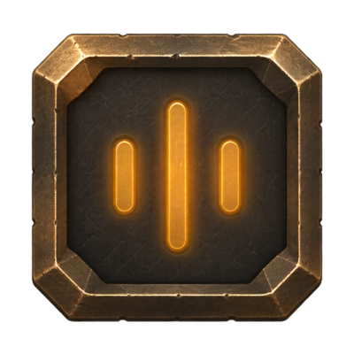
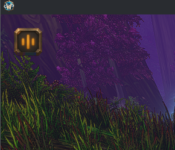

# Spoken Media Pause



Pause your music, video, or audiobook while [Spoken](https://www.curseforge.com/wow/addons/spoken) narrates in World of Warcraft. The desktop helper sends separate Pause and Play commands to compatible players and resumes only the same items it paused.

Get the **companion addon** for your WoW client and the **desktop helper** for your operating system from the [latest release](https://github.com/Pocketpac/SpokenMediaPlayPause/releases/latest).

| Platform | Download | Requirements |
| --- | --- | --- |
| Windows | [Standalone x64 EXE](https://github.com/Pocketpac/SpokenMediaPlayPause/releases/latest/download/Spoken-Media-Pause-Windows-x64-Beta.exe) · [Windows setup](#windows-setup) | **Beta.** Targets Windows 11. Windows 10 compatibility is unverified. |
| Linux | [All Players AppImage](https://github.com/Pocketpac/SpokenMediaPlayPause/releases/latest/download/Spoken-Media-Pause-All-Players-Ubuntu-22.04-x86_64.AppImage) · [Linux setup](#linux-setup) | x86-64 with glibc 2.35 or newer, including Ubuntu 22.04 |

On both platforms, use WoW in **Windowed** or **Windowed (Fullscreen)** mode. Exclusive fullscreen may make the in-game marker unreadable.

## Install the addon

1. Install Spoken or the matching port and a voice pack for your client.
2. Download the matching companion ZIP below. The same ZIP works with both desktop helpers.
3. With WoW closed, extract the ZIP into that client's `Interface/AddOns` folder. The resulting path should be `Interface/AddOns/SpokenMediaPause/SpokenMediaPause.lua`.
4. At the character selection screen, open **AddOns** and enable Spoken (or SoftSpoken) and **Spoken Media Pause**. After logging in, look for the [brass badge](#in-game-marker) in the top-left corner.

| WoW client | Companion download |
| --- | --- |
| WoW Forever, Classic Era, or Burning Crusade Classic (Anniversary) | [Standard addon 0.5.2](https://github.com/Pocketpac/SpokenMediaPlayPause/releases/latest/download/SpokenMediaPause-0.5.2.zip) |
| Original WotLK 3.3.5a with the [Spoken WotLK port](https://github.com/PatchFoundry335/spoken-wow) | [WotLK addon 0.5.2](https://github.com/Pocketpac/SpokenMediaPlayPause/releases/latest/download/SpokenMediaPause-0.5.2-WotLK-3.3.5a.zip) (experimental) |
| Original Vanilla 1.12 with [SoftSpoken](https://github.com/z1xel/SoftSpoken) | [Vanilla addon 0.5.2](https://github.com/Pocketpac/SpokenMediaPlayPause/releases/latest/download/SpokenMediaPause-0.5.2-Vanilla-1.12-SoftSpoken.zip) (experimental) |

## Windows setup

1. Download and double-click `Spoken-Media-Pause-Windows-x64-Beta.exe`. The standalone download bundles the .NET runtime. The beta EXE is unsigned.
2. Start WoW in **Windowed** or **Windowed (Fullscreen)** mode. Keep the top-left corner of the game visible, with the helper window out of the way. The helper finds WoW and reads up to 200 × 160 pixels from that corner.
3. [Test playback and automatic pause](#test-playback-and-automatic-pause).

Windows playback uses Windows system media sessions. The player must expose Pause, Play, and item information through that interface.

## Linux setup

1. Download the All Players AppImage above. Open a terminal in the download folder, then make the AppImage executable and start it.

   ```sh
   chmod +x Spoken-Media-Pause-All-Players-Ubuntu-22.04-x86_64.AppImage
   ./Spoken-Media-Pause-All-Players-Ubuntu-22.04-x86_64.AppImage
   ```

2. Start WoW and choose the capture method that matches how the game is running.

   | WoW display mode | What to do |
   | --- | --- |
   | X11 or XWayland | Leave the helper open. It finds WoW automatically and reads only the upper-left 200 × 160 pixels of the game window. This also applies to WoW running under XWayland on a Wayland desktop. |
   | Native Wayland | Click **Share WoW Window** in the helper. Choose WoW in your desktop's screen-sharing picker and approve sharing. This uses the desktop's screen-sharing portal and PipeWire. |

3. [Test playback and automatic pause](#test-playback-and-automatic-pause).

If the AppImage reports a FUSE or mount error, use this launch command after making it executable. [AppImage FUSE help](https://docs.appimage.org/user-guide/troubleshooting/fuse.html)

```sh
./Spoken-Media-Pause-All-Players-Ubuntu-22.04-x86_64.AppImage --appimage-extract-and-run
```

If your Wayland picker offers only monitor sharing, close the helper and relaunch with `--display`. Select the monitor and position WoW so its marker is near that monitor's top-left corner.

```sh
./Spoken-Media-Pause-All-Players-Ubuntu-22.04-x86_64.AppImage --display
```

Linux playback works with players that expose Pause, Play, and track or item information through MPRIS. The helper uses D-Bus directly and needs neither `playerctl` nor a browser extension.

## In-game marker



Look for the small brass badge just inside the top-left corner of WoW. Click it to turn automatic pause off or back on.

- **Unlit bars** mean auto-pause is enabled and Spoken is idle.
- **Glowing amber bars**, as shown above, mean Spoken is narrating and the desktop helper should pause compatible media.
- **A diagonal slash** means auto-pause is off.

Use the desktop helper from the same release to read the brass badge. In WoW chat, enter `/smp classic` to use the six-color marker with an earlier helper, or `/smp brass` to return to the new badge.

If the marker disappears or freezes during a resolution or display mode change, the helper keeps its last pause decision until it can read a live marker again. When narration ends, you turn auto-pause off, or the helper detects that WoW or the capture session has closed, it releases any automatic pauses it still owns. If the marker stays unreadable, close the helper to release its pause.

## Test playback and automatic pause

1. **Check your player.** Start a song, video, or audiobook in your player. Click **Test Pause**, then **Test Play** in the helper. Both buttons work with WoW closed. **Test Play** resumes the same item paused by **Test Pause**.
2. **Check Spoken.** With your media playing and the helper running, trigger a voiced quest or NPC dialogue in WoW. Your media should pause while Spoken speaks and resume when narration ends.
3. **Check the toggle.** Click the [in-game badge](#in-game-marker) during narration. The slash should appear and the helper should release its pause. Click again to re-enable auto-pause.

If the test buttons have no effect, confirm your media is playing in a player that exposes your operating system's media controls. Try a regular track or video if a live stream fails. If the buttons work but automatic pause fails, check that both addons are enabled, Spoken is playing audible narration, and the marker is visible and enabled. On native Wayland, also check which window or monitor you shared.

## Verification

- **Linux** 0.5.2 companion build passed the Ubuntu 22.04 library check, X11 capture and automatic pause/resume with a simulated WoW window, and both playback buttons with no game window. Earlier builds were tested on XWayland and KDE Wayland window and monitor sharing.
- **Windows** marker and playback logic checks passed on Linux, where the beta EXE was built.
- **Addon 0.5.2** was checked with simulated WoW APIs. Both companions passed rendered brass and classic marker checks. Live Classic and legacy gameplay remain untested.

[SHA-256 checksums](https://github.com/Pocketpac/SpokenMediaPlayPause/releases/latest/download/SHA256SUMS-all.txt) · [Linux build instructions](packaging/README.md) · [Windows build instructions](windows/README.md#build-from-source)

## License

The original Spoken Media Pause code is available under the [MIT License](LICENSE). Third-party components are governed by their respective licenses.
